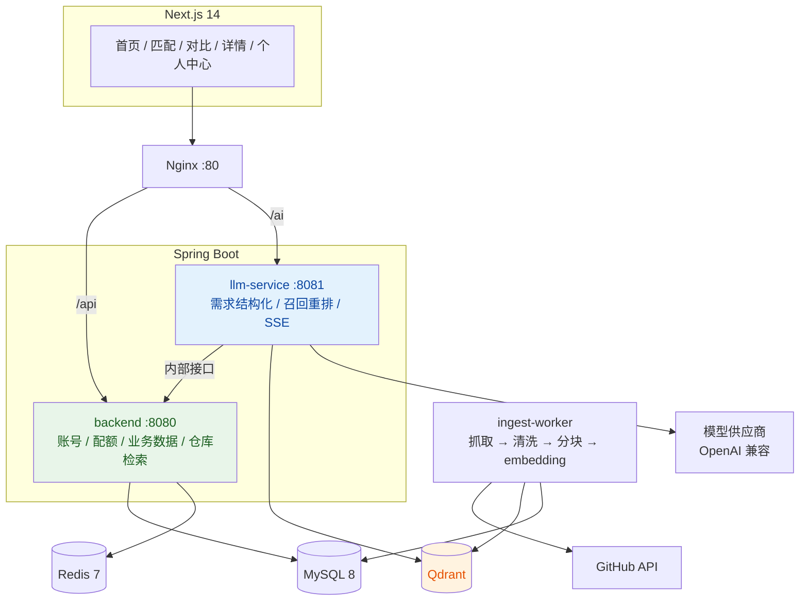

<div align="center">

# GitStarts

**描述你的想法，找到能直接用上的开源项目**

从「GitHub 热门仓库聚合」升级为「输入想法 → 匹配开源项目 → AI 深读 → 横向对比 → 决策沉淀」的开源方案决策平台

[](https://openjdk.org/)
[](https://spring.io/projects/spring-boot)
[](https://nextjs.org/)
[](https://www.mysql.com/)
[](https://redis.io/)
[](https://docs.docker.com/compose/)

</div>

---

## 这是什么

GitStarts 起初是一个 GitHub 热门仓库聚合站：定时采集仓库的 star / fork / 语言 / topics，提供榜单、搜索与详情。

现在它正在演进为一个**开源方案匹配与对比平台**：

> 我有一个想法，但不知道有没有现成的开源项目 —— 用自然语言描述需求，拿到高契合度候选；候选太多不知道选哪个 —— 让 AI 读项目，按统一维度做横向对比，并为每个结论附上证据。

## 解决什么问题

| 痛点 | GitStarts 的做法 |
|---|---|
| 想法有了，不知道搜什么关键词 | 自然语言 → 需求结构化（硬条件 / 软偏好 / 排除项） |
| 候选太多，只看 star 不靠谱 | 语义召回 + 硬过滤 + 重排，输出**可解释的契合度分解**，而不是一个魔法分 |
| 关心「能不能用到我的场景」 | 部署方式、许可证、平台、活跃度可过滤、可解释 |
| 选型过程难以复盘 | 收藏、对比历史、会话记录、Markdown 导出 |

## 核心流程


契合度不再是一个不可解释的分数，而是显式分解：

```
fit = 0.45 × 语义相关
    + 0.25 × 硬条件覆盖（must 命中率）
    + 0.15 × 维护活跃度（pushed_at / star 增速 / 是否 archived）
    + 0.15 × 许可证与生态适配
```

## 核心能力（规划）

- **需求结构化**：只抽取用户明说的条件，不确定项降级为软偏好，禁止臆造许可证与部署方式。
- **混合召回**：MySQL 硬过滤 → Qdrant 向量召回 → 关键词补充 → LLM 重排（只允许 ±0.1 调整并给出理由）。
- **AI 深读**：按 Markdown 标题切分 README、清洗后入索引，回答基于 `[TOOL_DATA]` 与段落证据。
- **逐格证据对比**：8 个固定维度（定位 / 技术栈 / 部署 / 能力覆盖 / 许可 / 活跃度 / 扩展性 / 风险），每个单元格标注证据或「信息不足」。
- **成本与配额**：普通用户 30 次对话 + 3 次深度对比每天；对比结果按文档版本缓存 7 天。
- **可观测**：模型、token、延迟、工具调用全链路记录，日用量汇总与告警。

## 当前进度

**已实现（基线）**

- GitHub 采集：定时全量 / 增量同步、令牌桶限流、Redis 分布式锁、采集日志
- 查询 API：仓库列表（搜索 / 平台 / 语言 / 分类 / 许可 / 排序 / 分页）、详情、相关推荐、README 摘要、榜单、聚合元数据、健康检查
- 前端：首页、仓库列表、仓库详情（Next.js App Router + Tailwind）
- 部署：Docker Compose 编排 MySQL / Redis / 后端 / 前端 / Nginx
- 缓存：热点数据 Redis 缓存
- **M0 工程基座**：`llm-service`（FastAPI + structlog + requestId）、`ingest-worker`、Qdrant、Nginx `/ai/` 与 `/api/internal/` 隔离、新视觉设计令牌与首页骨架
- **M1 账号会话与配额**：GitHub OAuth 登录闭环、Spring Session Redis（7 天）、每日配额 Redis 原子扣减、`/ai/**` 未登录 401（Nginx auth_request）、登录页与 `/me`、`/compare` 路由保护
- **M2 仓库数据补强**：`platform` 规则推导与筛选、许可证与更新时间筛选、详情页 README 摘要与相关推荐、首页平台/统计模块、列表与详情新视觉及移动端筛选抽屉

**规划中（AI 升级）**

| 里程碑 | 内容 | 状态 |
|---|---|---|
| M0 | 工程基座与视觉系统：`llm-service` 骨架、Qdrant、Nginx `/ai/` 与内部接口隔离 | 已完成 |
| M1 | GitHub OAuth、会话（Spring Session）、每日配额原子扣减 | 已完成 |
| M2 | 仓库数据补强：`platform` 字段、许可与更新时间筛选、相关推荐 | 已完成 |
| M3 | AI 网关与对话 MVP：SSE 流式、工具调用（`search_repos` / `get_repo` / `get_rank`） | 待启动 |
| M4 | 语义索引与匹配：README 分块 embedding、召回重排、`/ai/match` | 待启动 |
| M5 | 深读与对比工作台：逐维度证据、结论建议、缓存与导出 | 待启动 |
| M6 | 个性化沉淀：收藏、历史、画像、分享链接 | 待启动 |
| M7 | 上线打磨：压测、成本看板、安全复检、可访问性 | 待启动 |

## 架构



分层职责是硬约束，用来防止耦合回潮：

| 服务 | 负责 | 不允许 |
|---|---|---|
| `frontend` | 页面、SSE 消费、流式渲染 | 持有模型 Key、拼 prompt、直连向量库 |
| `backend` | 账号、配额、持久化、仓库检索（唯一数据出口） | 引入模型 SDK、感知 prompt 与模型厂商 |
| `llm-service` | 唯一模型出口、prompt、工具编排、重排、SSE | 直连 MySQL、判断业务权限 |
| `ingest-worker` | 抓取、清洗、分块、embedding、写索引 | 对外提供业务 API |

## 技术栈

| 层 | 选型 |
|---|---|
| 后端 | Java 17 · Spring Boot 3.5 · MyBatis-Plus |
| AI 网关 | Python 3.12 · FastAPI · LangGraph · langchain-openai |
| 认证 | Spring Security · OAuth2 Client · Spring Session Redis |
| 存储 | MySQL 8 · Redis 7 · Qdrant 1.x |
| 前端 | Next.js 14（App Router）· TypeScript · Tailwind CSS |
| 模型 | OpenAI 兼容协议（默认 SiliconFlow：DeepSeek）；embedding 本地 fastembed（1024 维多语言模型），可切供应商 API |
| 部署 | Nginx · Docker Compose |

## 快速开始

环境要求：Docker + Docker Compose；本地开发另需 JDK 17、Maven 3.9+、Node.js 20+、Python 3.12 + uv。

```bash
git clone https://github.com/xxh11432/GitStarts.git
cd GitStarts
cp .env.example .env
# 编辑 .env：MySQL / Redis 密码，GITHUB_TOKEN（提升 API 限流），LLM_API_KEY（M3 起）
docker compose up -d --build
```

首次 `--build` 会预热 embedding 模型（约 2 GB），构建较慢；可设 `PREWARM_MODELS=false` 跳过，模型改在首次请求时下载。

> 从 M0 升级到 M1 时，已有 MySQL 数据卷不会自动执行新增表；`deploy/init.sql` 全部使用 `CREATE TABLE IF NOT EXISTS`，可安全重跑：
> `docker compose exec -T mysql mysql -uroot -p"$MYSQL_ROOT_PASSWORD" < deploy/init.sql`。
> 同时在 `.env` 填入 GitHub OAuth App 的 `AUTH_GITHUB_CLIENT_ID` / `AUTH_GITHUB_CLIENT_SECRET`，回调地址设为 `http://<host>/api/auth/github/callback`。
>
> 从 M1 升级到 M2 时，已有数据库需补 `repositories.platform` 列与索引（新库由 `deploy/init.sql` 直接创建，无需执行）：
> `docker compose exec -T mysql sh -c 'mysql -uroot -p"$MYSQL_ROOT_PASSWORD" "$MYSQL_DATABASE" -e "ALTER TABLE repositories ADD COLUMN platform VARCHAR(32) NULL AFTER category, ADD INDEX idx_platform(platform), ADD INDEX idx_pushed_at(pushed_at)"'`。
> 平台字段在应用启动时会为存量仓库自动回填。

启动后访问 `http://localhost`（Nginx → 前端，`/api/` 反代到后端，`/ai/` 反代到 llm-service）。`/api/internal/**` 对外直接 404。

```bash
curl http://localhost/ai/health   # {"status":"ok|degraded", ...}
```

本地开发：

```bash
# 后端
cd backend
mvn spring-boot:run

# 前端
cd frontend
npm install
npm run dev

# AI 网关（8081）
cd llm-service
uv sync
uv run uvicorn app.main:app --reload --port 8081

# 索引 worker（占位，M4 起执行抓取/索引任务）
cd llm-service
uv run python -m worker
```

关键环境变量：

| 变量 | 说明 |
|---|---|
| `GITHUB_TOKEN` | GitHub PAT，用于提升 Search / REST 限流 |
| `SYNC_ENABLED` | 是否启用定时采集，本地开发可设 `false` |
| `AUTH_GITHUB_CLIENT_ID` / `AUTH_GITHUB_CLIENT_SECRET` | GitHub OAuth App 凭据；回调地址填 `http://<host>/api/auth/github/callback` |
| `AUTH_GITHUB_REDIRECT_URI` / `APP_FRONTEND_URL` | 回调地址与登录成功后的前端回跳地址 |
| `SESSION_COOKIE_SECURE` | 会话 Cookie 是否仅 HTTPS 发送；生产开启，本地 HTTP 需为 `false` |
| `QUOTA_CHAT_DAILY` / `QUOTA_COMPARE_DAILY` | 每日对话 / 深度对比额度（默认 30 / 3） |
| `API_INTERNAL_URL` | 前端 SSR 访问后端的内部地址 |
| `LLM_BASE_URL` / `LLM_API_KEY` | 模型网关地址与密钥（仅 llm-service 可见） |
| `LLM_CHAT_MODEL` / `LLM_EMBEDDING_MODEL` | 对话与向量模型（默认 DeepSeek + 1024 维多语言 embedding） |
| `EMBEDDING_PROVIDER` | `fastembed`（本地，默认）或 `api` |
| `PREWARM_MODELS` | 镜像构建期是否预热 embedding 模型 |
| `INTERNAL_TOKEN` | 服务间调用鉴权（M0 起） |
| `QDRANT_URL` | 向量库地址（M0 起） |

## 目录结构

```
GitStarts/
├── backend/                  # Spring Boot 后端
│   └── src/main/java/com/githubstars/
│       ├── collector/        # GitHub 采集、限流、调度
│       ├── controller/       # 仓库 / 元数据 / 账号 / 配额 / 内部接口
│       ├── security/         # OAuth2 登录、会话、CSRF、内部接口鉴权
│       ├── service/          # 查询、榜单、同步、缓存、用户、配额
│       ├── mapper/ entity/   # MyBatis-Plus
│       └── config/           # Redis、线程池、调度
├── frontend/                 # Next.js 14
│   ├── app/                  # 首页 / 仓库 / 登录 / 个人中心 / 对比
│   ├── components/           # Navbar / HeroComposer / RepoCard / FilterBar / LoginButton / QuotaBadge
│   └── lib/                  # API 封装、客户端会话与 CSRF 工具、类型
├── llm-service/              # Python AI 网关（API 与 worker 同镜像）
│   ├── app/                  # FastAPI：api / core / clients / schemas
│   ├── worker/               # python -m worker，APScheduler 任务入口
│   ├── tests/                # pytest（SSE 与工具契约测试）
│   ├── pyproject.toml        # uv 依赖与 ruff / pytest 配置
│   └── Dockerfile            # 多阶段构建，含 embedding 预热
├── deploy/init.sql           # MySQL 建表与初始化
├── nginx/nginx.conf          # 反向代理（/api/、/ai/、内部接口隔离）
├── doc/                      # 技术方案
└── docker-compose.yml
```

## API 概览

现有接口（前缀 `/api`）：

| 方法 | 路径 | 说明 |
|---|---|---|
| GET | `/api/repos` | 列表：搜索 / 平台 / 语言 / 分类 / 许可 / 排序（stars·forks·pushedAt·created）/ 分页 |
| GET | `/api/repos/rank` | 榜单（total / trend / new） |
| GET | `/api/repos/similar/{fullName}` | 相关推荐：topics 重合、语言 / 平台 / 分类匹配、star 接近度 |
| GET | `/api/repos/{owner}/{repo}/readme` | README 纯文本摘要（按需读取 GitHub 并缓存，失败时返回空摘要） |
| GET | `/api/repos/{fullName}` | 仓库详情 |
| GET | `/api/meta` | 分类、语言、标签、平台聚合 |
| GET | `/api/auth/github/login` | 发起 GitHub 登录，支持 `next` 回跳 |
| GET | `/api/auth/me` | 当前登录用户与今日配额（未登录 401） |
| POST | `/api/auth/logout` | 退出登录（需 CSRF token） |
| GET | `/api/quota` | 今日对话 / 对比配额（未登录 401） |
| GET | `/api/health` | 健康检查 |
| GET | `/ai/health` | AI 网关健康检查（含 Qdrant 连通性，始终 200） |

服务间接口（`X-Internal-Token`，Nginx 对外 404）：`POST /api/internal/quota/reserve`（原子扣减，超限 429）、`GET /api/internal/auth/session`（供 Nginx `auth_request` 校验会话并回传 `X-User-Id`）。`/ai/**` 除 `/ai/health` 外均要求登录，未登录由 Nginx 返回 401 JSON。

规划接口：`POST /ai/match`、`POST /ai/chat/stream`、`POST /ai/compare`，均以 SSE 推送事件（`parsed` / `status` / `candidate` / `cell` / `verdict` / `done` / `error`），业务侧 `/api/auth/*`、`/api/ideas`、`/api/favorites`、`/api/quota`。服务间接口统一收在 `/api/internal/`，Nginx 对外直接返回 404。

## 数据与索引

- **MySQL**：`repositories`（仓库主表，含 `category` 规则分类与 `platform` 平台维度）+ `tags` / `repo_tags`（分类与标签）+ `sync_logs`（采集日志）；AI 阶段新增 `users` / `ideas` / `conversations` / `messages` / `comparisons` / `favorites` / `usage_daily`。
- **Qdrant**：`repo_chunks` 集合，dense 向量（默认 1024 维，cosine），按 Markdown 标题切成 400–800 tokens、重叠 80，payload 带 `language` / `category` / `license` / `stars` / `pushed_at` 供过滤。本地 embedding 使用 fastembed（fastembed 未提供 bge-m3 ONNX 版本，默认 `intfloat/multilingual-e5-large`；需要 bge-m3 时切 `EMBEDDING_PROVIDER=api`）。
- **缓存**：匹配结果 10 分钟、对比结果 7 天、榜单与元数据 5 分钟、embedding 按 chunk hash 永久。

## 安全与合规

- 模型 Key 只存在 `llm-service` 环境变量，前端与后端均不可见。
- 会话 Cookie `httpOnly + Secure + SameSite=Lax`，写接口启用 CSRF token。
- `/api/internal/**` 外网 404；服务间调用需 `X-Internal-Token`。
- README 与用户输入一律视为不可信：清洗 HTML、工具结果包裹、Markdown 禁止 raw HTML。
- 只缓存公开 README 并标注来源，不复制全文分发，遵循 GitHub API 条款。

## 文档

- [完整方案（v1.1，Python + LangGraph）](doc/AI匹配与对比平台完整方案.md)
- [技术方案（基线）](doc/技术方案.md)：技术栈、表结构、采集引擎与阶段计划

## 贡献

欢迎提 Issue 讨论需求与选型场景。提交 Pull Request 前请确保：`mvn -q package`、`npm run build`、`uv run ruff check`、`uv run pytest` 通过，新增接口附带最小可复现示例。
